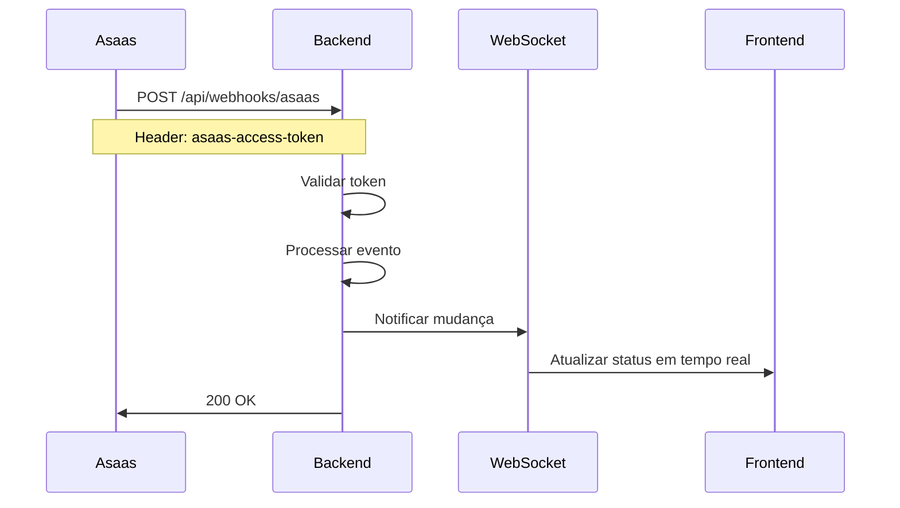

# 🔔 Configuração do Webhook Asaas - ServiJa

## ✅ Status da Configuração

- ✅ **Token de Segurança:** Gerado e configurado no `.env`
- ✅ **Controller:** Já implementado em `AsaasWebhookController.java`
- ✅ **Service:** Já implementado em `AsaasWebhookService.java`
- ⚠️ **Webhook no Asaas:** Precisa ser configurado manualmente no painel

---

## 🎯 Configuração Manual Necessária

### 1️⃣ Acesse o Painel do Asaas

🔗 **URL:** https://www.asaas.com/login

Navegue para: **Configurações** → **Integrações** → **Webhooks** → **Novo Webhook**

---

### 2️⃣ Dados para Configurar o Webhook

#### **Ambiente de Produção**

| Campo | Valor |
|-------|-------|
| **Nome** | `ServiJa Payment Webhook - Production` |
| **URL** | `https://servija.app/api/webhooks/asaas` |
| **Email** | `servija8@gmail.com` |
| **Token de Autenticação** | `a1/VlaJoShmhsOeGXHJBQOHpwdReybpDM+imiAnv0t8=` |
| **Versão da API** | `3` |
| **Tipo de Envio** | `SEQUENCIAL (SEQUENTIALLY)` |
| **Status** | `Ativo` |

#### **Ambiente de Homologação** (Opcional)

| Campo | Valor |
|-------|-------|
| **Nome** | `ServiJa Payment Webhook - Homolog` |
| **URL** | `https://homolog.servija.app/api/webhooks/asaas` |
| **Email** | `servija8@gmail.com` |
| **Token de Autenticação** | `a1/VlaJoShmhsOeGXHJBQOHpwdReybpDM+imiAnv0t8=` |
| **Versão da API** | `3` |
| **Tipo de Envio** | `SEQUENCIAL (SEQUENTIALLY)` |
| **Status** | `Ativo` |

---

### 3️⃣ Eventos Configurados

✅ **Você configurou todos os eventos de pagamento do Asaas!** Aqui está o que cada um significa:

#### **Eventos Críticos - Pagamento Confirmado**
- ✅ `PAYMENT_CONFIRMED` - Pagamento confirmado (saldo ainda não disponibilizado) ⭐
- ✅ `PAYMENT_RECEIVED` - Pagamento recebido (saldo disponível) ⭐

#### **Eventos de Autorização e Análise**
- ✅ `PAYMENT_AUTHORIZED` - Cartão autorizado (aguardando captura)
- ✅ `PAYMENT_AWAITING_RISK_ANALYSIS` - Aguardando análise manual de risco
- ✅ `PAYMENT_APPROVED_BY_RISK_ANALYSIS` - Aprovado pela análise de risco
- ✅ `PAYMENT_REPROVED_BY_RISK_ANALYSIS` - Reprovado pela análise de risco ⚠️

#### **Eventos de Ciclo de Vida**
- ✅ `PAYMENT_CREATED` - Cobrança criada
- ✅ `PAYMENT_UPDATED` - Cobrança atualizada
- ✅ `PAYMENT_DELETED` - Cobrança removida
- ✅ `PAYMENT_RESTORED` - Cobrança restaurada

#### **Eventos de Problemas**
- ✅ `PAYMENT_OVERDUE` - Pagamento vencido
- ✅ `PAYMENT_CREDIT_CARD_CAPTURE_REFUSED` - Captura de cartão recusada ⚠️
- ✅ `PAYMENT_BANK_SLIP_CANCELLED` - Boleto cancelado por expiração

#### **Eventos de Estorno**
- ✅ `PAYMENT_REFUNDED` - Pagamento estornado totalmente
- ✅ `PAYMENT_PARTIALLY_REFUNDED` - Pagamento estornado parcialmente
- ✅ `PAYMENT_REFUND_IN_PROGRESS` - Estorno em processamento
- ✅ `PAYMENT_REFUND_DENIED` - Estorno negado

#### **Eventos de Chargeback** ⚠️ **IMPORTANTE**
- ✅ `PAYMENT_CHARGEBACK_REQUESTED` - Chargeback solicitado 🚨
- ✅ `PAYMENT_CHARGEBACK_DISPUTE` - Em disputa de chargeback
- ✅ `PAYMENT_AWAITING_CHARGEBACK_REVERSAL` - Disputa vencida, aguardando repasse

#### **Eventos de Split**
- ✅ `PAYMENT_SPLIT_CANCELLED` - Split cancelado
- ✅ `PAYMENT_SPLIT_DIVERGENCE_BLOCK` - Valor bloqueado por divergência de split
- ✅ `PAYMENT_SPLIT_DIVERGENCE_BLOCK_FINISHED` - Bloqueio finalizado

#### **Eventos de Visualização**
- ✅ `PAYMENT_BANK_SLIP_VIEWED` - Boleto visualizado pelo cliente
- ✅ `PAYMENT_CHECKOUT_VIEWED` - Checkout visualizado pelo cliente

#### **Eventos de Antecipação e Negativação**
- ✅ `PAYMENT_ANTICIPATED` - Pagamento antecipado
- ✅ `PAYMENT_DUNNING_REQUESTED` - Negativação solicitada
- ✅ `PAYMENT_DUNNING_RECEIVED` - Recebimento de negativação

#### **Outros Eventos**
- ✅ `PAYMENT_RECEIVED_IN_CASH_UNDONE` - Recebimento em dinheiro desfeito

---

## 🎯 O que o Sistema Faz com Cada Evento

### ✅ Eventos Tratados Automaticamente

| Evento | Ação do Sistema |
|--------|-----------------|
| `PAYMENT_CONFIRMED` / `PAYMENT_RECEIVED` | ✅ Atualiza status para COMPLETED<br>✅ Adiciona saldo na carteira do freelancer<br>✅ Notifica cliente via WebSocket<br>✅ Muda solicitação para COMPLETED |
| `PAYMENT_REPROVED_BY_RISK_ANALYSIS` | ⚠️ Atualiza status para FAILED<br>⚠️ Notifica cliente da falha |
| `PAYMENT_CREDIT_CARD_CAPTURE_REFUSED` | ⚠️ Atualiza status para FAILED<br>⚠️ Notifica cliente da falha |
| `PAYMENT_REFUNDED` / `PARTIALLY_REFUNDED` | 🔄 Atualiza status para REFUNDED |
| `PAYMENT_CHARGEBACK_REQUESTED` | 🚨 Atualiza status para CHARGEBACK<br>🚨 Registra log de alerta |
| `PAYMENT_OVERDUE` | ⏰ Atualiza status para OVERDUE |
| `PAYMENT_DELETED` | ❌ Atualiza status para CANCELLED |
| `PAYMENT_RESTORED` | ♻️ Atualiza status para PENDING |

### 📊 Eventos Monitorados (Log)

Todos os outros eventos são registrados nos logs para análise e auditoria.

---

## 🔒 Segurança - IMPORTANTE

### ⚠️ API Key Comprometida

A tentativa de configuração automática falhou com erro 401. Isso indica que:

1. **A API key pode estar expirada**
2. **A API key pode ter sido revogada**
3. **A API key pode não ter permissões suficientes**

### 🛡️ Ação Necessária

1. Acesse o painel do Asaas
2. Vá em **Configurações** → **Integrações** → **API Keys**
3. **Revogue a API key atual**
4. **Gere uma nova API key** com permissões completas
5. Atualize o arquivo `.env`:

```bash
ASAAS_API_KEY=<sua_nova_api_key_aqui>
```

---

## 🧪 Como Testar

### Teste 1: Verificar se o endpoint está acessível

Execute o script de teste:

```powershell
powershell -ExecutionPolicy Bypass -File "test-webhook-endpoint.ps1"
```

### Teste 2: Validar no painel do Asaas

Após configurar o webhook no painel:

1. O Asaas enviará uma requisição de teste para sua URL
2. Verifique nos logs do backend se a requisição foi recebida
3. Teste criando um pagamento e veja se o webhook é disparado

### Teste 3: Monitorar logs

Monitore os logs do backend para ver os webhooks chegando:

```bash
# Em produção
docker logs -f servija_backend_prod

# Ou no console do Spring Boot
# Procure por: "Webhook recebido do Asaas"
```

---

## 📊 Como Funciona



---

## 🔧 Arquivos Relacionados

### Backend
- `AsaasWebhookController.java` - Recebe os webhooks
- `AsaasWebhookService.java` - Processa os eventos
- `WebSocketService.java` - Notifica o frontend em tempo real
- `PaymentService.java` - Atualiza status dos pagamentos

### Frontend  
- `usePaymentWebSocket.ts` - Escuta atualizações em tempo real
- `CheckoutPage.vue` - Atualiza UI quando pagamento confirmado

### Configuração
- `.env` - Variáveis de ambiente (token, API key)
- `application.properties` - Configuração do Spring Boot

---

## 📝 Notas Importantes

1. **O webhook DEVE ser acessível pela internet** - O Asaas precisa conseguir fazer requisições HTTP para sua URL

2. **HTTPS é obrigatório em produção** - O Asaas só aceita URLs HTTPS (não HTTP)

3. **Token de segurança** - O token configurado no Asaas deve ser o mesmo do `.env`

4. **Ordem de eventos** - Use `SEQUENTIALLY` para garantir que os eventos sejam processados na ordem correta

5. **Retry automático** - Se seu endpoint falhar, o Asaas tentará reenviar o webhook automaticamente

---

## ❓ Problemas Comuns

### Webhook não está sendo recebido

1. Verifique se o backend está rodando e acessível
2. Teste a URL manualmente: `curl https://servija.app/api/webhooks/asaas`
3. Verifique os logs do Asaas no painel (pode ter erros lá)

### Token inválido (401)

1. Verifique se o token no `.env` é o mesmo configurado no Asaas
2. Certifique-se de que não há espaços extras no token

### Eventos não estão atualizando o frontend

1. Verifique se o WebSocket está conectado
2. Veja os logs do backend para confirmar que o evento foi processado
3. Teste o composable `usePaymentWebSocket.ts`

---

## 📞 Suporte

Se precisar de ajuda:

1. Verifique a documentação oficial do Asaas: https://docs.asaas.com/reference/webhooks
2. Consulte os logs do backend para erros
3. Teste o endpoint manualmente com ferramentas como Postman

---

**Data de configuração:** 02/03/2026  
**Token gerado:** `a1/VlaJoShmhsOeGXHJBQOHpwdReybpDM+imiAnv0t8=`  
**Status:** ⚠️ Aguardando configuração manual no painel do Asaas
