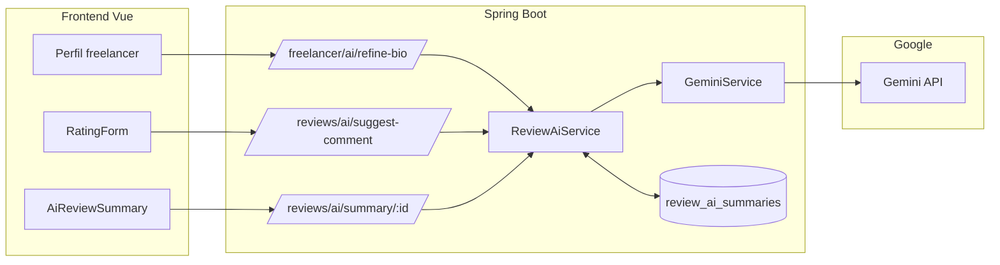

# Uso de inteligência artificial no ServiJá

Documentação técnica com base no código do repositório. O sistema emprega **Google Gemini** (biblioteca oficial `google-genai`) para três capacidades assistivas ligadas a **perfil de freelancer** e **avaliações**. Não há outros provedores de modelo generativo identificados nesta análise.

**Nota:** o arquivo `tcc-servija/references/TCC.md` referenciado pela skill de documentação não está presente neste clone; a estrutura segue banco → backend → frontend.

---

## 1. Visão geral da arquitetura

| Camada | Responsabilidade |
|--------|-------------------|
| **Infra** | Chave e modelo configuráveis (`gemini.api.key`, `gemini.model`); variáveis de ambiente em `application.properties` e `docker-compose*.yml` (`GEMINI_API_KEY`, `GEMINI_MODEL`). |
| **Serviço de baixo nível** | `GeminiService` encapsula `Client.models.generateContent` e trata erros (incl. quota 429). |
| **Regras de negócio / prompts** | `ReviewAiService` monta prompts em PT-BR, pós-processa texto ou JSON e persiste resumos em cache. |
| **API HTTP** | `FreelancerAiController` (refino de bio) e `ReviewAiController` (sugestão de comentário e resumo agregado). |
| **Frontend** | `freelancerService.refineBio`, `reviewService.suggestComment` e `reviewService.getAiSummary`; componentes Vue listados na seção 4. |

A categoria de serviço **“IA Aplicada”** em `backend/src/main/resources/catalog/service-category-catalog.json` é apenas **nome de subcategoria** no catálogo comercial, não integração técnica com modelo.

---

## 2. Banco de dados

### 2.1. Tabela `review_ai_summaries`

Migration `backend/src/main/resources/db/migration/V47__create_review_ai_summaries.sql`:

- `id`, `freelancer_id` (único, FK para `freelancers(user_id)` com `ON DELETE CASCADE`).
- `summary_json` (`TEXT`): JSON com `strengths`, `attentionPoints` e `overall`.
- `review_count`: quantidade de avaliações considerada na última geração.
- `generated_at`: momento da geração (usada na política de cache).

Entidade JPA: `backend/src/main/java/com/servija/servija/model/ReviewSummary.java` (tabela `review_ai_summaries`).

**Invalidação indireta:** ao criar uma nova avaliação (`ReviewService.createReview`), se existir resumo para o freelancer avaliado, o código atualiza `generated_at` para **dois dias no passado** (`reviewSummaryRepository`), o que força o resumo a ser considerado “velho” na lógica de cache de 24 horas de `ReviewAiService`, além de eventual divergência de `review_count` após nova avaliação — favorecendo **regeneração** na próxima consulta.

---

## 3. Backend

### 3.1. Dependência e configuração

- **Maven:** `backend/pom.xml` — artefato `com.google.genai:google-genai` (versão 1.46.0 no trecho analisado).
- **Propriedades:** `backend/src/main/resources/application.properties` — `gemini.api.key=${GEMINI_API_KEY}`, `gemini.model=${GEMINI_MODEL:gemini-2.5-flash}`; também há chaves `google.project.*` declaradas (uso além do `GeminiService` não foi rastreado nesta tarefa focada em IA generativa).

### 3.2. `GeminiService`

Arquivo: `backend/src/main/java/com/servija/servija/service/GeminiService.java`.

- `@PostConstruct` registra modelo e prefixo da chave (sem expor a chave completa).
- `generateText(String prompt)` instancia `com.google.genai.Client` com a API key, chama `generateContent` com o modelo configurável e retorna `response.text()` trimado.
- Erros de **quota** (mensagens contendo `429`, `quota`, `RESOURCE_EXHAUSTED`) são mapeados para mensagem amigável em português.

### 3.3. `ReviewAiService`

Arquivo: `backend/src/main/java/com/servija/servija/service/ReviewAiService.java`.

**Constantes:** mínimo de **3** avaliações para gerar resumo agregado; comentário sugerido limitado a **480** caracteres; cache de **24 horas** quando o número de reviews não mudou.

1. **`refineBio(String bio)`** — Prompt de sistema/usuário em texto fixo: papel de redator de perfis de freelancers no Brasil; preservar conteúdo; corrigir gramática; primeira pessoa; máximo 1000 caracteres; resposta só com o texto. Resposta truncada se ultrapassar 1000 caracteres.

2. **`suggestComment(...)`** — Monta prompt com nota (1–5), tags, nome do serviço e do freelancer, e opcionalmente **texto já escrito** pelo cliente (modo “refinar” vs “gerar do zero”). Regras: comentário entre 80 e 200 caracteres, honesto/construtivo, sem inventar fatos fora do texto original quando há texto original. Limite 480 no código (intervalo do prompt fala em 80–200).

3. **`getOrGenerateSummary(Long freelancerId)`** — Se menos de 3 reviews, retorna `AiSummaryResponse.unavailable()`. Caso contrário, se existir registro em `review_ai_summaries` com `generated_at` dentro de 24h **e** `review_count` igual ao atual, devolve JSON parseado sem chamar o Gemini. Senão, monta prompt com até **20** avaliações (nota, tags, comentário), pede **apenas JSON** com chaves `strengths`, `attentionPoints`, `overall`; usa `extractJson` para remover cercas markdown se o modelo as incluir; persiste ou atualiza `ReviewSummary`. Em falha de parse ou exceção, retorna `unavailable()` (com log).

### 3.4. Controllers e DTOs

- **`FreelancerAiController`** — `POST /api/freelancer/ai/refine-bio`, corpo `RefineBioRequest` (`bio`), resposta `RefineBioResponse` com `refinedBio`. Valida bio vazia com 400; exceções → 500.
- **`ReviewAiController`** — prefixo `/api/reviews/ai`:
  - `POST /suggest-comment` — corpo `AiCommentRequest` (rating, tags, serviceName, freelancerName, existingComment); resposta `AiCommentResponse` com `suggestion`. Requer autenticação na cadeia global (não está em `permitAll`).
  - `GET /summary/{freelancerId}` — retorno `AiSummaryResponse` (`available`, listas, `overall`, `generatedAt`).

DTO agregado: `backend/src/main/java/com/servija/servija/dto/AiSummaryResponse.java` — método estático `unavailable()`.

### 3.5. Segurança (`SecurityConfig`)

Arquivo: `backend/src/main/java/com/servija/servija/config/SecurityConfig.java`.

- `GET /api/reviews/ai/summary/**` está em **`permitAll`**, ou seja, **qualquer cliente** pode consultar o resumo de IA de um freelancer por ID **sem JWT**. Os demais endpoints de IA seguem a regra `anyRequest().authenticated()` (incluindo `POST /api/reviews/ai/suggest-comment` e `POST /api/freelancer/ai/refine-bio`).

**Lacuna / implicação para documentação acadêmica:** vale descrever explicitamente essa escolha (exibição pública de síntese gerada por modelo) e o risco de **abuso de cota** ou **enumeração** de resumos, se relevante ao trabalho.

### 3.6. Testes automatizados

`backend/src/test/java/com/servija/servija/service/ReviewAiServiceTest.java` — testes com `GeminiService` mockado cobrindo `suggestComment`, truncamento e `getOrGenerateSummary` (cache, indisponibilidade, falha do Gemini).

---

## 4. Frontend

### 4.1. Serviços HTTP

- `frontend/src/api/services/freelancerService.ts` — `refineBio(bio)` → `POST /freelancer/ai/refine-bio`.
- `frontend/src/api/services/reviewService.ts` — `suggestComment`, `getAiSummary(freelancerId)` com tipos `AiCommentRequest` / `AiCommentResponse` / `AiSummaryResponse`.

Base URL: `VITE_API_URL` + `/api` (`frontend/src/api/config/axios.ts`).

### 4.2. Componentes e fluxo do usuário

| Componente | Uso da IA |
|------------|-----------|
| `frontend/src/components/freelancer/FreelancerProfessionalProfile.vue` | Ao refinar, substitui a bio editada pelo retorno de `freelancerService.refineBio`. |
| `frontend/src/components/shared/RatingForm.vue` | Ação “sugerir comentário” chama `reviewService.suggestComment` com nota, tags, nome do serviço/freelancer e comentário atual; preenche o campo de texto com a sugestão. |
| `frontend/src/components/freelancer/AiReviewSummary.vue` | No `onMounted`, chama `getAiSummary`; se `available`, exibe card “Análise por IA” com síntese, pontos fortes e pontos de atenção; falha silenciosa (card omitido). |

---

## 5. Fluxo resumido

---

## 6. Conclusão

No ServiJá, a **IA generativa** está concentrada no **Google Gemini**, via `GeminiService` e `ReviewAiService`, com três funções: **refino de biografia**, **sugestão/refino de texto de avaliação** e **resumo agregado de avaliações** com persistência e cache em `review_ai_summaries`. O frontend consome essas APIs em perfil, formulário de avaliação e card de “Análise por IA”. Para o TCC, destacam-se: política de **cache e invalidação** ao nova avaliação, limites de tamanho e de quantidade de reviews no prompt, tratamento de **quota**, e a decisão de segurança de expor o **GET de resumo** sem autenticação.
