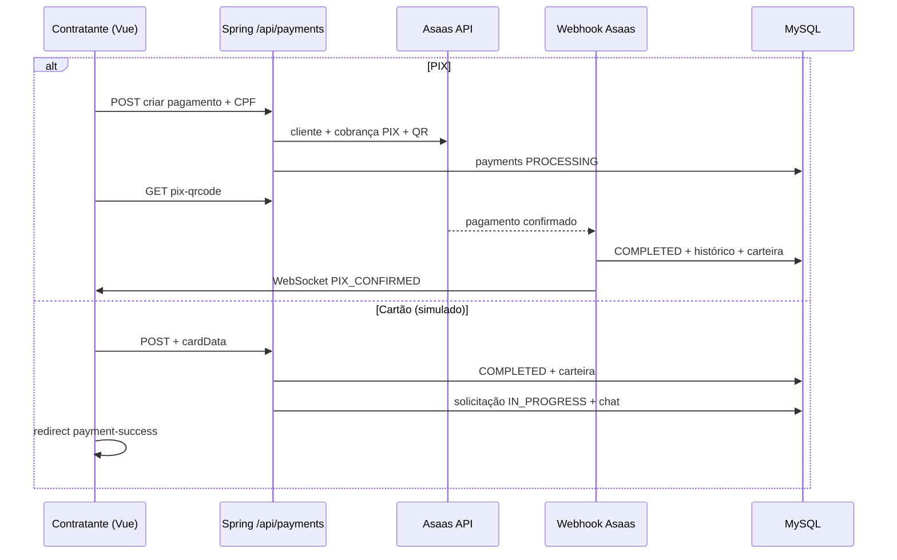

# Pagamento no ServiJá

Documentação técnica do fluxo de pagamento entre contratante (cliente) e freelancer, com base no código do repositório. **Nota:** o arquivo de referência indicado pela skill (`tcc-servija/references/TCC.md`) não foi encontrado neste clone; a estrutura segue banco → backend → frontend, com rastreabilidade por caminhos de arquivo.

---

## 1. Visão geral

O pagamento associa-se a uma **solicitação de serviço** (`service_requests`) já **aceita** (`ACCEPTED`). O contratante autenticado é quem cria o pagamento; o valor cobrado do cliente corresponde ao **valor acordado** (`responseValue` ou `counterValue`). A plataforma retém **5%** como taxa (`platform_fee`); o freelancer credita na carteira o valor líquido (`amount` = 95% do acordado). Taxas do gateway Asaas são calculadas em `gateway_fee` como **custo interno** (não repassadas ao cliente no fluxo analisado).

Integração financeira: **Asaas** (API REST v3), com webhooks em `/api/webhooks/asaas`. Métodos tratados no serviço principal: **PIX** (cobrança real no Asaas), **cartão de crédito** (fluxo **simulado** no backend, aprovação instantânea) e **wallet** (simulado, status `PROCESSING`).

---

## 2. Banco de dados

### 2.1. Tabela `payments`

Criação inicial em `backend/src/main/resources/db/migration/V20__create_payments_table.sql`:

| Conceito | Colunas / observação |
|----------|----------------------|
| Identificação | `id`, `service_request_id`, `contractor_id`, `freelancer_id` (FKs com `ON DELETE CASCADE`) |
| Valores | `amount` (líquido freelancer), `platform_fee`, `total_amount` (total pago pelo cliente) |
| Método e status | `payment_method`, `status` (string no SQL; entidade JPA usa enum) |
| Rastreamento | `transaction_id`, `pix_qr_code`, `pix_copy_paste`, `card_last_digits`, `refund_reason`, `completed_at`, timestamps |

Evoluções relevantes:

- **V21** (`V21__add_asaas_fields_to_payments.sql`): `asaas_payment_id`, `asaas_customer_id` e índices.
- **V23** (`V23__add_gateway_fee_to_payments.sql`): `gateway_fee`.
- **V26** (`V26__add_payment_history_and_chat_enabled.sql`): tabela `payment_status_history`; índice `asaas_payment_id`; coluna `service_requests.chat_enabled` (chat liberado quando há pagamento concluído).
- **V27** (`V27__add_pix_transaction_fields_to_payments.sql`): `pix_transaction_id`, `pix_end_to_end_id`, `pix_transaction_status` (rastreio de transação PIX no Asaas).

### 2.2. Tabela `payment_status_history`

Modelo JPA: `backend/src/main/java/com/servija/servija/model/PaymentStatusHistory.java`. Campos: `payment_id`, `status`, `asaas_event`, `details`, `created_at`. Usada para auditoria de mudanças de status (criação, webhook, simulação de teste).

### 2.3. Enum de status (`Payment.PaymentStatus`)

Definido em `backend/src/main/java/com/servija/servija/model/Payment.java`: `PENDING`, `PROCESSING`, `COMPLETED`, `FAILED`, `REFUNDED`, `CANCELLED`, `OVERDUE`, `CHARGEBACK`.

---

## 3. Backend

### 3.1. API REST — `PaymentController`

Arquivo: `backend/src/main/java/com/servija/servija/controller/PaymentController.java`  
Prefixo: `/api/payments` (protegido por JWT, exceto onde o framework aplicar regras globais).

| Método | Caminho | Função |
|--------|---------|--------|
| `POST` | `/` | Criar pagamento |
| `GET` | `/{id}` | Detalhe do pagamento |
| `GET` | `/my` | Lista do usuário (contratante ou freelancer) |
| `GET` | `/{id}/status` | Consulta status no Asaas e sincroniza |
| `PATCH` | `/{id}/status` | Atualização manual de status (corpo `{ "status": "..." }`) |
| `GET` | `/{id}/pix-qrcode` | Dados do QR Code / payload PIX |
| `GET` | `/service-request/{serviceRequestId}` | Pagamento mais recente da solicitação |
| `GET` | `/{id}/history` | Histórico de status |
| `GET` | `/{id}/receipt-url` | URLs de recibo no Asaas |
| `POST` | `/{id}/simulate-confirmation` | **Teste:** simula confirmação PIX (marcado para remoção em produção) |

### 3.2. DTOs

- **Entrada:** `backend/src/main/java/com/servija/servija/dto/PaymentRequest.java` — `serviceRequestId`, `paymentMethod`, `amount`, `cpf` opcional, `cardData` (número, nome, validade, CVV) para cartão.
- **Saída:** `backend/src/main/java/com/servija/servija/dto/PaymentResponse.java` — inclui `platformFee`, `gatewayFee`, `totalAmount`, `pixQrCode`, `pixCopyPaste`, `asaasPaymentId`, etc.

### 3.3. Regras de negócio — `PaymentService`

Arquivo: `backend/src/main/java/com/servija/servija/service/PaymentService.java`.

**Pré-condições em `createPayment`:**

1. Usuário existe e é o **contratante** da solicitação.
2. Status da solicitação = `ACCEPTED`.
3. Não pode existir outro pagamento para a mesma solicitação (`existsByServiceRequest`).
4. `amount` da requisição deve ser **igual** ao valor acordado (`validatePaymentAmount`).
5. Valor mínimo R$ 20,00 salvo exceção `legacyLowValueAllowed` na solicitação (`validateMinimumPaymentAmount`).
6. CPF/CNPJ do pagador obrigatório (perfil ou campo `cpf`).

**Cálculo financeiro:**

- `totalAmount` = valor acordado (100% pago pelo cliente).
- `platformFee` = 5% do acordado.
- `amount` (carteira freelancer) = acordado − taxa da plataforma.
- `gatewayFee` depende do método (constantes Asaas PIX/boleto/cartão).

**PIX:** `getOrCreateCustomer` + `AsaasService.createPayment` (`billingType` PIX) + `getPixQrCode`; preenche `asaas_payment_id`, QR em base64 prefixado com `data:image/png;base64,`, copia-e-cola; status do pagamento → `PROCESSING`.

**Cartão:** `processCreditCardPayment` valida dados, guarda últimos 4 dígitos, marca `COMPLETED` imediatamente, chama `FreelancerWalletService.addPendingBalance`, **sem** chamada ao Asaas para cobrança de cartão (log indica simulação).

**Carteira (`wallet`):** apenas status `PROCESSING` e log (simulação).

**Após `COMPLETED` no ato da criação (cartão):** solicitação → `IN_PROGRESS`, `chatEnabled = true`, histórico da solicitação (`PAYMENT_CONFIRMED`), WebSocket (`notifyServiceRequestStatusChange`, `notifyPixPaymentConfirmed` para cliente e freelancer — nome genérico mesmo para cartão), `notificationService.notifyProjectStarted`.

**Consulta manual de status:** `checkAsaasPaymentStatus` consulta Asaas, mapeia status, em caso de `COMPLETED` atualiza `completedAt` e chama `addPendingBalance`. **Lacuna documental com base no código:** neste método **não** há atualização de `ServiceRequest` para `IN_PROGRESS`, nem habilitação de chat, nem notificações/WebSocket — diferente do fluxo de webhook e do cartão simulado. Quem depende só do `GET .../status` pode ficar com pagamento concluído e solicitação ainda `ACCEPTED` até outro mecanismo atuar.

**Teste local:** `simulatePaymentConfirmation` reproduz efeitos próximos ao webhook (pagamento completo, carteira, solicitação, WebSocket, notificação).

### 3.4. Integração Asaas — `AsaasService`

Arquivo: `backend/src/main/java/com/servija/servija/service/AsaasService.java`. Configuração: `asaas.api.url`, `asaas.api.key`. Destaques: criação/atualização de cliente com **notificações desativadas** (custo de mensageria); `createPayment` POST `/v3/payments`; `getPixQrCode` GET `/v3/payments/{id}/pixQrCode`; `getPaymentStatus`; `getPaymentReceiptUrl` (extrai `transactionReceiptUrl` e `invoiceUrl`).

### 3.5. Webhooks — `AsaasWebhookController` / `AsaasWebhookService`

- `POST /api/webhooks/asaas` — eventos gerais; cabeçalho `asaas-access-token` comparado a `asaas.webhook.token`.
- `POST /api/webhooks/asaas/pix-transaction` — transações PIX.

Em `AsaasWebhookService`, confirmação de pagamento (ex.: `PAYMENT_RECEIVED` / confirmado) e fluxo **PIX_TRANSACTION_DONE** atualizam pagamento para `COMPLETED`, histórico, `addPendingBalance`, passam solicitação para `IN_PROGRESS`, `chatEnabled`, notificações e WebSocket — alinhado ao comportamento esperado após pagamento efetivo.

### 3.6. Carteira do freelancer

`FreelancerWalletService.addPendingBalance` (`backend/src/main/java/com/servija/servija/service/FreelancerWalletService.java`): cria carteira se não existir e incrementa saldo **pendente** (liberação para disponível é responsabilidade de outros fluxos, p.ex. `releasePendingBalance` ligado a pagamento e prazos).

### 3.7. Lacunas / divergências frontend × backend

O arquivo `frontend/src/api/services/paymentService.ts` declara métodos `getReceipt`, `downloadReceiptPdf` e `requestRefund` apontando para rotas `/payments/...` que **não** aparecem no `PaymentController` pesquisado — tratam-se de **código cliente não espelhado** por esses endpoints no backend atual, salvo outro controller não mapeado nesta análise.

---

## 4. Frontend

### 4.1. Rotas

`frontend/src/router/index.ts`: `/checkout` (`CheckoutPage` em `frontend/src/pages/Checkout/index.vue`), `/payment-success` (`PaymentSuccess`).

### 4.2. Checkout da página pai

`frontend/src/pages/Checkout/index.vue`:

- Lê `requestId` da query; carrega `GET /api/service-requests/{id}` (axios com `baseURL` … `/api`).
- Exige status `ACCEPTED` e preço negociado (`responseValue` ou `counterValue`).
- **Cartão (e fluxo que chama `onConfirmPayment`):** delega a `paymentService.createPayment` e redireciona para `/payment-success?paymentId=...`.

### 4.3. Componente de checkout

`frontend/src/components/payment/CheckoutPage.vue`:

- **PIX:** cria pagamento com `fetch` direto em `POST /api/payments` com `paymentMethod: 'PIX'`, `amount` e `cpf` (após validação de 11 dígitos); em seguida `GET /api/payments/{id}/pix-qrcode`. Trata erro “Já existe um pagamento” buscando pagamento existente e recarregando QR.
- **Cartão:** chama `onConfirmPayment` do pai com `cardData` e valor.
- **WebSocket:** `usePaymentWebSocket` (`frontend/src/composables/usePaymentWebSocket.ts`) — destino STOMP `/topic/payment/{email}`; eventos como `PIX_CONFIRMED` redirecionam para `/payment-success`.
- **Simulação:** botão de teste chama `POST /api/payments/{id}/simulate-confirmation`.

Comentário no componente: taxa de plataforma exibida como zero para o cliente (`platformFee = 0` no computed), coerente com o desconto ser do lado do freelancer no backend.

### 4.4. Página de sucesso

`frontend/src/pages/PaymentSuccess/index.vue`: carrega `paymentService.getPayment(paymentId)`; recibo via `getReceiptUrl`. O rótulo “Valor Total” usa `paymentData.amount` — no backend, `PaymentResponse.amount` é o **líquido do freelancer**, não o `totalAmount` pago pelo cliente; possível **ambiguidade de UI** em relação ao texto exibido.

### 4.5. Cliente HTTP

`frontend/src/api/config/axios.ts`: `baseURL` = `{VITE_API_URL}/api`. `paymentService.createPayment` usa `POST /payments`.

---

## 5. Fluxo resumido (mermaid)

---

## 6. Conclusão

O ServiJá modela pagamentos na tabela `payments`, com histórico em `payment_status_history` e integração **Asaas** para **PIX** e dados de cliente/cobrança/recibo. A **taxa da plataforma (5%)** e o **líquido do freelancer** estão explícitos em `PaymentService`. O **cartão** e a **carteira** são tratados como fluxos simplificados ou simulados no código atual. Para o TCC, vale destacar a **separação de caminhos**: confirmação via **webhook** (e cartão simulado) avança a solicitação e o chat; a **consulta pontual** `GET /payments/{id}/status` completa pagamento e carteira, mas **não** replica todas essas atualizações no trecho analisado de `PaymentService`.
