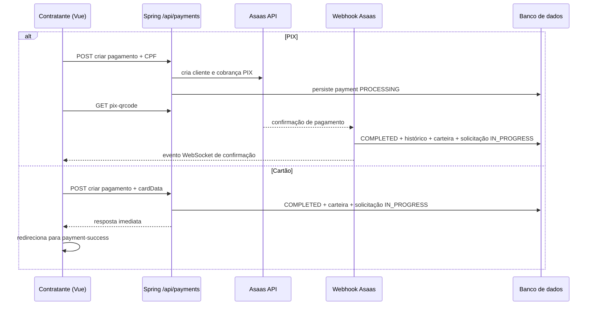

# Pagamento no Servi Já

Documentação técnica do fluxo de pagamento entre contratante e freelancer, com base no código atual do repositório. O objetivo deste material é descrever a implementação real do módulo, destacando suas regras de negócio, integração externa, comportamento no frontend e limitações observadas.

---

## 1. Visão geral

O pagamento do Servi Já está vinculado a uma **solicitação de serviço** já aceita (`service_requests` com status `ACCEPTED`). O contratante autenticado é quem inicia a cobrança, e o valor pago deve corresponder exatamente ao valor negociado na solicitação (`responseValue` ou `counterValue`).

O backend calcula três valores principais:

- `totalAmount`: valor total pago pelo cliente.
- `platformFee`: taxa da plataforma, fixada em 5% do valor acordado.
- `amount`: valor líquido destinado ao freelancer, já descontada a taxa da plataforma.

Além disso, o sistema registra `gatewayFee`, que representa o custo operacional do gateway Asaas. Essa taxa é tratada como custo interno da plataforma e não é adicionada ao preço exibido ao contratante no fluxo analisado.

Os métodos contemplados pelo serviço principal são:

- `pix`: cobrança real via Asaas.
- `credit-card`: fluxo atualmente simulado no backend, com confirmação imediata.
- `wallet`: fluxo previsto no serviço de pagamento, mas sem exposição visual na tela atual de checkout.

Importante: a funcionalidade de **carteira** já existe no sistema atual, com frontend e backend próprios. O que ainda não está implementado na interface analisada é a seleção do método `wallet` como forma de pagamento do contratante durante o checkout.

---

## 2. Banco de dados

### 2.1. Tabela `payments`

A criação inicial da tabela está em `backend/src/main/resources/db/migration/V20__create_payments_table.sql`.

Principais colunas:

| Grupo | Colunas |
|------|---------|
| Identificação | `id`, `service_request_id`, `contractor_id`, `freelancer_id` |
| Valores | `amount`, `platform_fee`, `total_amount`, `gateway_fee` |
| Método e status | `payment_method`, `status` |
| Integração | `asaas_payment_id`, `asaas_customer_id`, `transaction_id` |
| PIX | `pix_qr_code`, `pix_copy_paste`, `pix_transaction_id`, `pix_end_to_end_id`, `pix_transaction_status` |
| Cartão e reembolso | `card_last_digits`, `refund_reason` |
| Datas | `completed_at`, `created_at`, `updated_at` |

Relacionamentos principais:

- `service_request_id` referencia a solicitação que originou o pagamento.
- `contractor_id` referencia o usuário contratante.
- `freelancer_id` referencia o usuário prestador.

No SQL de criação, essas chaves estrangeiras usam `ON DELETE CASCADE`, o que faz com que pagamentos vinculados sejam removidos quando o registro-pai for excluído.

Migrações relevantes:

- `V21__add_asaas_fields_to_payments.sql`: adiciona integração com Asaas.
- `V23__add_gateway_fee_to_payments.sql`: adiciona `gateway_fee`.
- `V26__add_payment_history_and_chat_enabled.sql`: cria o histórico de status e adiciona `chat_enabled` em `service_requests`.
- `V27__add_pix_transaction_fields_to_payments.sql`: adiciona campos específicos do PIX.

### 2.2. Tabela `payment_status_history`

Modelada em `backend/src/main/java/com/servija/servija/model/PaymentStatusHistory.java`, essa tabela registra a trilha de auditoria do pagamento.

Campos principais:

- `payment_id`
- `status`
- `asaas_event`
- `details`
- `created_at`

Seu papel é armazenar transições relevantes, como criação do pagamento, confirmação por webhook, atualização manual ou simulação de testes.

### 2.3. Enum de status

O enum `Payment.PaymentStatus`, definido em `backend/src/main/java/com/servija/servija/model/Payment.java`, contém os estados:

- `PENDING`
- `PROCESSING`
- `COMPLETED`
- `FAILED`
- `REFUNDED`
- `CANCELLED`
- `OVERDUE`
- `CHARGEBACK`

---

## 3. Backend

### 3.1. Controller principal: `PaymentController`

Arquivo: `backend/src/main/java/com/servija/servija/controller/PaymentController.java`

O prefixo do controller é `/api/payments`. No contexto atual de segurança, as rotas ficam sob autenticação JWT por regra global de `SecurityConfig`, enquanto os webhooks públicos ficam sob `/api/webhooks/**`.

Rotas principais:

| Método | Caminho | Método do controller | Função |
|------|---------|----------------------|--------|
| `POST` | `/` | `createPayment` | Cria um novo pagamento |
| `GET` | `/{id}` | `getPayment` | Busca detalhes de um pagamento |
| `GET` | `/my` | `getMyPayments` | Lista pagamentos do usuário autenticado |
| `GET` | `/{id}/status` | `checkPaymentStatus` | Consulta status no Asaas e sincroniza o pagamento |
| `PATCH` | `/{id}/status` | `updatePaymentStatus` | Atualiza manualmente o status |
| `GET` | `/{id}/pix-qrcode` | `getPixQrCode` | Retorna QR Code e payload PIX |
| `GET` | `/service-request/{serviceRequestId}` | `getPaymentByServiceRequest` | Retorna um pagamento associado à solicitação |
| `GET` | `/{id}/history` | `getPaymentHistory` | Retorna o histórico de status |
| `GET` | `/{id}/receipt-url` | `getReceiptUrl` | Retorna URLs de recibo/fatura do Asaas |
| `POST` | `/{id}/simulate-confirmation` | `simulatePaymentConfirmation` | Simula confirmação de pagamento para testes |

Observação importante sobre `GET /service-request/{serviceRequestId}`:

- Na implementação atual, `PaymentService.getPaymentByServiceRequestId` usa `PaymentRepository.findByServiceRequestId(...)` e retorna o primeiro item da lista.
- Como a consulta não possui ordenação explícita, o código atual não garante formalmente que esse item seja o pagamento "mais recente".

### 3.2. DTOs

#### Entrada: `PaymentRequest`

Arquivo: `backend/src/main/java/com/servija/servija/dto/PaymentRequest.java`

Campos principais:

- `serviceRequestId`
- `paymentMethod`
- `amount`
- `cpf`
- `cardData`

O objeto `cardData` encapsula:

- número do cartão
- nome do titular
- validade
- CVV

#### Saída: `PaymentResponse`

Arquivo: `backend/src/main/java/com/servija/servija/dto/PaymentResponse.java`

Campos relevantes:

- `id`
- `serviceRequestId`
- `amount`
- `platformFee`
- `gatewayFee`
- `totalAmount`
- `paymentMethod`
- `status`
- `pixQrCode`
- `pixCopyPaste`
- `asaasPaymentId`
- `completedAt`

### 3.3. Service principal: `PaymentService`

Arquivo: `backend/src/main/java/com/servija/servija/service/PaymentService.java`

Métodos mais importantes do módulo:

- `createPayment`
- `validatePaymentAmount`
- `validateMinimumPaymentAmount`
- `createPixPayment`
- `processCreditCardPayment`
- `getPaymentById`
- `getPaymentByServiceRequestId`
- `checkAsaasPaymentStatus`
- `getPixQrCode`
- `getPaymentHistory`
- `getReceiptUrl`
- `simulatePaymentConfirmation`

#### Regras de negócio em `createPayment`

Antes de persistir o pagamento, o serviço valida:

1. O usuário autenticado existe.
2. O usuário autenticado é o contratante da solicitação.
3. A solicitação está com status `ACCEPTED`.
4. Ainda não existe pagamento para a solicitação.
5. O valor informado é exatamente igual ao valor acordado.
6. O pagamento atende ao valor mínimo de R$ 20,00, salvo exceção de legado.
7. Há CPF/CNPJ disponível para o pagador.

#### Cálculo financeiro

- `totalAmount = valor acordado`
- `platformFee = 5% do valor acordado`
- `amount = valor acordado - platformFee`
- `gatewayFee = taxa interna calculada conforme o método`

#### Fluxo PIX

No pagamento via PIX, o backend:

1. Obtém ou cria o cliente no Asaas por `AsaasService.getOrCreateCustomer`.
2. Cria a cobrança por `AsaasService.createPayment`.
3. Busca o QR Code por `AsaasService.getPixQrCode`.
4. Persiste o pagamento com status `PROCESSING`.
5. Salva `asaas_payment_id`, `pix_qr_code` e `pix_copy_paste`.

#### Fluxo cartão de crédito

O método `processCreditCardPayment` valida os dados mínimos do cartão, armazena os últimos quatro dígitos e marca o pagamento como `COMPLETED` imediatamente.

Após isso, o sistema:

- adiciona saldo pendente na carteira do freelancer por `FreelancerWalletService.addPendingBalance`;
- altera a solicitação para `IN_PROGRESS`;
- habilita `chatEnabled`;
- registra histórico da solicitação;
- envia notificações e eventos WebSocket.

Esse fluxo é atualmente tratado como **simulado**, sem cobrança real de cartão no Asaas.

#### Fluxo `wallet`

O `switch` interno do serviço já contempla `wallet` como método válido. No estado atual:

- o pagamento entra em `PROCESSING`;
- o fluxo permanece simulado;
- não há integração operacional completa equivalente ao PIX;
- a tela de checkout analisada não disponibiliza essa opção ao contratante.

### 3.4. Consulta de status e limitações comportamentais

O método `checkAsaasPaymentStatus` consulta o Asaas e sincroniza o status do pagamento local.

Quando identifica conclusão:

- atualiza `status` para `COMPLETED`;
- preenche `completedAt`;
- adiciona saldo pendente na carteira do freelancer.

Porém, no trecho atual de `PaymentService`, esse método **não replica todo o fluxo de pós-confirmação** usado no cartão simulado e no webhook. Em particular, ele não garante:

- atualização da `ServiceRequest` para `IN_PROGRESS`;
- habilitação de `chatEnabled`;
- disparo completo de notificações;
- envio dos mesmos eventos WebSocket do fluxo principal.

Na prática, isso significa que uma consulta manual via `GET /payments/{id}/status` pode concluir o pagamento, mas deixar a solicitação em estado anterior até que outro mecanismo execute as demais transições.

### 3.5. Observação de segurança da implementação atual

Embora as rotas de pagamento estejam em contexto autenticado, várias operações de leitura e consulta não fazem, no trecho atual analisado, uma validação explícita de ownership no service.

Isso vale especialmente para:

- `getPayment`
- `checkPaymentStatus`
- `getPixQrCode`
- `getPaymentByServiceRequest`
- `getPaymentHistory`
- `getReceiptUrl`

Esses métodos recuperam registros por ID e retornam dados, mas não verificam de forma explícita, nesse ponto da implementação, se o usuário autenticado é parte autorizada daquele pagamento. Para fins de TCC, isso deve ser registrado como limitação da versão atual do módulo.

### 3.6. Integração com o Asaas

Arquivo: `backend/src/main/java/com/servija/servija/service/AsaasService.java`

Principais métodos utilizados:

- `getOrCreateCustomer`
- `createPayment`
- `getPixQrCode`
- `getPaymentStatus`
- `getPaymentReceiptUrl`

Características relevantes:

- usa `asaas.api.url` e `asaas.api.key`;
- cria clientes com notificações desativadas;
- cria cobranças via `POST /v3/payments`;
- consulta QR Code por `GET /v3/payments/{id}/pixQrCode`;
- consulta status e links de recibo/fatura.

### 3.7. Webhooks

Arquivos:

- `backend/src/main/java/com/servija/servija/controller/AsaasWebhookController.java`
- `backend/src/main/java/com/servija/servija/service/AsaasWebhookService.java`

Rotas:

- `POST /api/webhooks/asaas`
- `POST /api/webhooks/asaas/pix-transaction`

Quando o Asaas confirma o pagamento, o serviço de webhook:

- marca o pagamento como `COMPLETED`;
- grava histórico em `payment_status_history`;
- adiciona saldo pendente na carteira do freelancer;
- altera a solicitação para `IN_PROGRESS`;
- habilita o chat;
- envia notificações e eventos WebSocket.

Esse é o fluxo mais completo de confirmação efetiva do pagamento PIX.

### 3.8. Carteira do freelancer

Arquivo principal: `backend/src/main/java/com/servija/servija/service/FreelancerWalletService.java`

Métodos mais importantes:

- `addPendingBalance`
- `releasePendingBalance`

O método `addPendingBalance` cria a carteira do freelancer, se necessário, e incrementa o saldo pendente. O método `releasePendingBalance` trata a conversão do saldo pendente em saldo disponível em fluxos posteriores.

### 3.9. Divergências entre frontend e backend

O arquivo `frontend/src/api/services/paymentService.ts` declara métodos que não possuem endpoint correspondente no `PaymentController` analisado:

- `getReceipt`
- `downloadReceiptPdf`
- `requestRefund`

Esses métodos apontam para rotas que não aparecem no backend atual mapeado para pagamentos. Portanto, trata-se de divergência entre o cliente HTTP e a API disponível nesta versão do sistema.

---

## 4. Frontend

### 4.1. Rotas

As rotas principais do fluxo estão em `frontend/src/router/index.ts`:

- `/checkout`
- `/payment-success`

Os wrappers de página são:

- `frontend/src/pages/Checkout/index.vue`
- `frontend/src/pages/PaymentSuccess/index.vue`

### 4.2. Página de checkout: `frontend/src/pages/Checkout/index.vue`

Essa página orquestra o processo de pagamento.

Métodos e responsabilidades principais:

- leitura de `requestId` pela query string;
- carregamento da solicitação por `GET /api/service-requests/{id}`;
- validação de status `ACCEPTED`;
- chamada de `paymentService.createPayment(...)` no fluxo delegado pelo componente filho.

Há um detalhe importante:

- o tipo aceito por `handleConfirmPayment` contempla `pix`, `credit-card` e `wallet`;
- porém, a tela de checkout atual não renderiza uma opção visual para `wallet`.

### 4.3. Componente principal do checkout: `CheckoutPage.vue`

Arquivo: `frontend/src/components/payment/CheckoutPage.vue`

Principais métodos utilizados:

- `togglePaymentMethod`
- `generatePixQrCode`
- `loadPixQrCode`
- `checkExistingPayment`
- `handleContinue`
- `simulatePaymentConfirmation`

#### Fluxo PIX no frontend

O componente executa um fluxo próprio para PIX, usando `fetch` diretamente:

1. `POST /api/payments` com `paymentMethod: 'PIX'`, valor e CPF.
2. `GET /api/payments/{id}/pix-qrcode`.
3. Exibição do QR Code e do código copia-e-cola.
4. Abertura de escuta via WebSocket para confirmação.

Se o backend retorna erro indicando que já existe pagamento, o componente busca o pagamento existente por solicitação e recarrega o QR Code.

#### Fluxo cartão no frontend

No cartão, o componente coleta os dados do formulário e delega para o callback `onConfirmPayment`, implementado na página pai. Esse callback usa `paymentService.createPayment(...)`.

#### Métodos de pagamento exibidos na interface

Na implementação visual atual, o componente renderiza apenas:

- `PIX`
- `credit-card`

Apesar disso, o contrato tipado do frontend e o backend já contemplam `wallet` como possibilidade técnica.

### 4.4. WebSocket de pagamento

O componente usa `frontend/src/composables/usePaymentWebSocket.ts`.

Eventos relevantes observados:

- `PIX_CONFIRMED`
- `PAYMENT_FAILED`
- `PAYMENT_CANCELLED`
- `PAYMENT_STATUS_CHANGED`

Quando o pagamento é confirmado, o frontend redireciona o usuário para a tela de sucesso.

### 4.5. Módulo de carteira existente no sistema

A carteira não está restrita ao backend. Ela já possui implementação própria no frontend, por exemplo em:

- `frontend/src/api/services/walletService.ts`
- `frontend/src/pages/FreelancerWallet/index.vue`
- `frontend/src/components/freelancer/FreelancerWalletPage.vue`

No backend, a funcionalidade também está presente, incluindo controller e service específicos:

- `backend/src/main/java/com/servija/servija/controller/FreelancerWalletController.java`
- `backend/src/main/java/com/servija/servija/service/FreelancerWalletService.java`

Portanto, a limitação atual não é a inexistência da carteira no sistema, mas sim a ausência de uma opção visual de pagamento por carteira no checkout do contratante.

### 4.6. Página de sucesso

Arquivo: `frontend/src/pages/PaymentSuccess/index.vue`

Principais ações:

- carrega o pagamento por `paymentService.getPayment(paymentId)`;
- busca links de recibo por `paymentService.getReceiptUrl(paymentId)`.

Observação relevante de consistência:

- a interface exibe o rótulo "Valor Total";
- entretanto, o valor mostrado é `paymentData.amount`;
- no backend, `amount` representa o valor líquido do freelancer, não o total pago pelo cliente;
- o valor total pago pelo contratante está em `totalAmount`.

Para um texto acadêmico, isso deve ser registrado como ambiguidade de apresentação na interface atual.

### 4.7. Cliente HTTP

Arquivo: `frontend/src/api/config/axios.ts`

O frontend usa `baseURL = {VITE_API_URL}/api`. No entanto, o fluxo PIX em `CheckoutPage.vue` usa `fetch` direto para `/api/payments`, enquanto o fluxo padrão encapsulado em serviço usa `frontend/src/api/services/paymentService.ts`.

Isso mostra que o módulo de pagamento possui dois estilos de acesso HTTP convivendo no frontend:

- serviço centralizado por Axios;
- chamadas diretas por `fetch` dentro do componente.

---

## 5. Fluxo resumido

---

## 6. Conclusão

O módulo de pagamento do Servi Já possui uma modelagem consistente em `payments` e `payment_status_history`, integração efetiva com o Asaas para o fluxo PIX e integração com carteira do freelancer para apropriação financeira do valor líquido.

Do ponto de vista arquitetural, o backend concentra a lógica principal em `PaymentService`, enquanto o frontend divide a experiência entre uma página orquestradora (`Checkout/index.vue`), um componente operacional (`CheckoutPage.vue`) e uma tela de retorno (`PaymentSuccess/index.vue`).

Para fins de TCC, merecem destaque quatro aspectos da implementação atual:

1. O sistema separa corretamente valor total do cliente, taxa da plataforma e valor líquido do freelancer.
2. O webhook é o caminho mais completo e consistente para confirmação de pagamentos PIX.
3. A carteira já existe como módulo do sistema, mas ainda não está exposta como opção visual no checkout analisado.
4. Há limitações reais na versão atual, como ausência de validação explícita de ownership em algumas consultas, divergência entre métodos do frontend e endpoints do backend e ambiguidade de UI na exibição do valor total na tela de sucesso.
